[](https://github.com/elias-sundqvist/obsidian-annotator/releases/latest)


# Annotator

Read and annotate PDFs, EPUB books, web pages and videos inside
[Obsidian](https://obsidian.md), and keep what you mark as Markdown in your
vault. Every annotation is a block in an ordinary note, so it links, embeds,
searches and syncs like the rest of your notes.

Website: [annotator.esh.sh](https://annotator.esh.sh/).

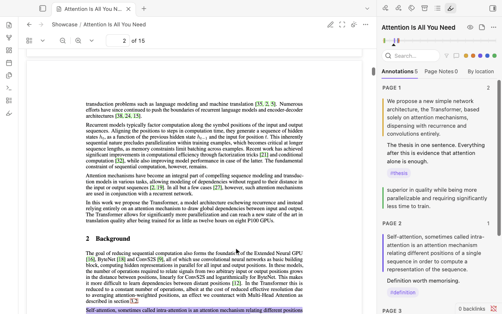

Version 0.3 is a new reader. Earlier versions showed the Hypothesis web client
in a frame; this one is built on Obsidian's own PDF view and editor. Your
annotation notes are read and written in the same format as before:
[Coming from Annotator 0.2](#coming-from-annotator-02) says what changes.

## Install

In Obsidian: **Settings → Community plugins → Browse**, search for
"Annotator", install and enable it. It needs Obsidian 1.11.4 or later and
works on desktop (macOS, Windows, Linux) and Android. On iOS and iPadOS the
reader has been tested in the iOS Simulator; a check inside Obsidian on an
iPhone or iPad is still to come.

## Start

- Open a PDF or a book from your vault and run **Open annotations sidebar**
  from the command palette. Select text to highlight it or write a note.
- Or make a note with an `annotation-target` property that names a file or a
  web address, and open it.
- **Open annotated source…** lists everything you have annotated.

The rest of this page says what you can do and how.

## Where annotations live

Each source has one annotation note: a Markdown note with an
`annotation-target` property that names the source. Open the note, or the
source, and the reader shows both. The note is yours to move, rename and edit;
the sidebar's menu has **Open annotation note**.

A new annotation note starts with the heading "Annotations". In the settings
you can choose another heading, or name a template note: its properties and
text are kept (`{{title}}`, `{{date}}` and `{{target}}` are filled in) and
annotations are added after it.

The `annotation-target` may be written in any of the usual ways:

| Written as | Example |
| --- | --- |
| A path in the vault | `annotation-target: Papers/Attention.pdf` |
| A wikilink | `annotation-target: "[[Attention.pdf]]"` |
| An embed | `annotation-target: "![[Attention.pdf]]"` |
| A Markdown link | `annotation-target: "[Attention](Papers/Attention.pdf)"` |
| A web address | `annotation-target: https://arxiv.org/pdf/1706.03762` |
| An HTML file in the vault | `annotation-target: "[[Saved page.html]]"` |
| A Dataview inline field | `annotation-target:: [[Attention.pdf]]` in the note's text |

A name that differs from a file's only by the kind of space in it (a no-break
space pasted from a web page) still finds that file.

### The note is the source's property sheet

A PDF or a book cannot carry properties of its own, so the annotation note is
where they go: tags, a status, an author, whatever you list your reading by.
The note opens its source, and **Add the PDF's details to the note** makes
the note (with the PDF's title, authors and year) even before the first
highlight. A Base that lists everything you have annotated needs one filter:

```yaml
filters:
  and:
    - '!note["annotation-target"].isEmpty()'
views:
  - type: table
    name: Sources
    order:
      - file.name
      - note.annotation-target
      - note.annotation-progress
      - note.author
      - note.year
```

`annotation-progress` is there when
[reading progress](#reading-progress) is kept in the note.

Nothing is stored anywhere else. If a block in the note is damaged (a sync
conflict, a slip of the hand), the readable annotations are still shown, the
sidebar names the damaged part with a button to its line, and nothing is
written until you have repaired it.

## Highlighting and notes

Select text. A small bar appears with six inks and **Note**.

- A colour highlights the passage. `H` highlights in the last colour used,
  `1`–`6` pick a colour, `A` opens a note on the passage.
- A note is written in Obsidian's own editor: links, tags, lists and
  formatting work as in any note. `Ctrl/Cmd+Enter` saves, `Escape` cancels.
- A selection may run over a page break in a PDF; it is one highlight.
- In the sidebar, a card's quote takes you to the passage; its actions edit,
  reply, copy a link to the annotation, or delete. Deleting can be undone.
- **Page notes** (the second tab) are notes about the whole source. One
  written while a PDF page or a book chapter is in view remembers it: its card
  says "Page 12" (or the chapter) and goes there, and in an exported PDF it
  sits on that page.

The sidebar can sort by place or by date, filter by colour or to what has a
note, and search
(`tag:idea`, `text:…`, `quote:…`, `since:7day` narrow it). The strip at its top
shows where the annotations fall in the source and where you are.

To search every annotation in the vault at once, run **Search all
annotations…**: type a few letters of a quote, a note, a `#tag` or a source's
title, and choosing a result opens its source at the passage.

## PDFs

The reader works on Obsidian's built-in PDF view. Three buttons are added to
the view's header, and a fourth while it has something to do: after you
follow a link inside the PDF (a citation, a contents entry), **Back to page
N** returns you to where you were. The command *PDF: go back to where a link
was followed* does the same and can be given a hotkey.

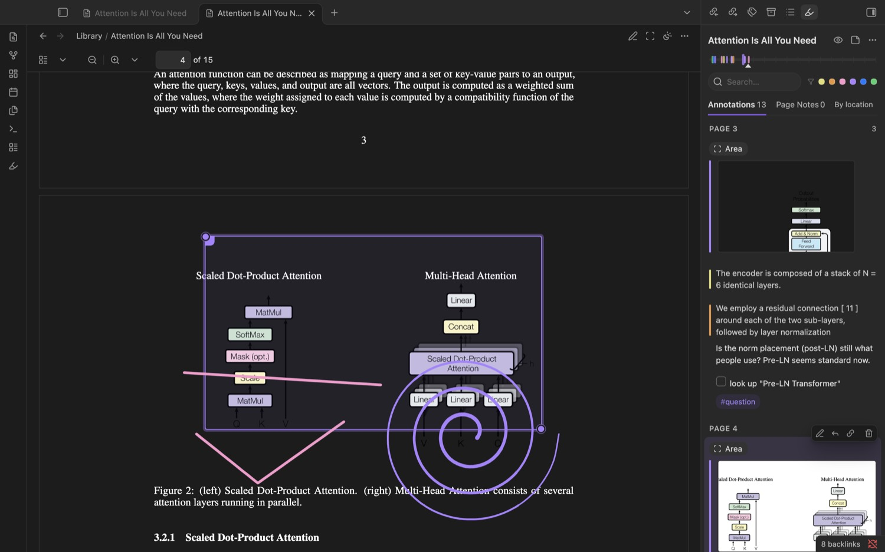

**Page appearance** chooses the paper: Auto (follows your theme), Light,
Sepia, or Dark. The Sepia paper is a styling variable (see
[STYLING.md](docs/STYLING.md)), so it can be parchment or anything else.

On a dark page the text is light and pictures are left as they are, so a
line drawing in black on a clear ground can vanish. **Darken pictures too**
(in the same card) turns the whole page instead: drawings and diagrams show,
and photographs look like negatives. Pictures you keep of areas are taken
from the page as printed either way.

**Mark an area** keeps a picture of part of a page with a note: a figure, a
table, an equation. Drag over the part to keep, or press `Enter` to place a
frame and move it with the arrow keys. The picture is saved as an attachment
and leads the note. The words that lie inside the area are kept with it, so a
picture of a table is found by what it says.

- Select a saved area to move it (arrow keys, or the grip at its top-left
  corner) or resize it (`Shift`+arrow keys, or the grip at its bottom-right).
  Its picture is taken again.
- A PDF that is pictures of pages (a scan) has no text to select. The sidebar
  says so and offers areas and drawing, which work on any page.

**Draw on the page** is freehand: underline, circle, point, write in the
margin. The toolbar has the six inks, three pens, an eraser, Undo, Done and
Cancel.

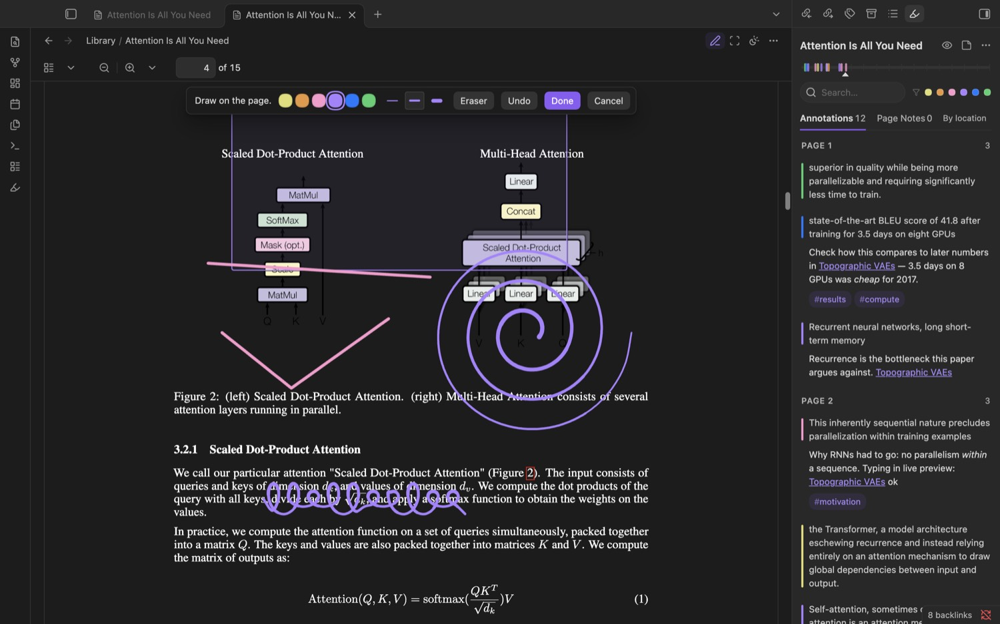

- A pen that reports pressure draws thinner and thicker; fast strokes are
  smoothed. Once a pen has drawn, a finger moves the page instead of drawing.
- The eraser (the button, or the other end of the pen) removes whole strokes.
  `Ctrl/Cmd+Z` takes back the last change, an erasure too. `Enter` or Done
  keeps the drawing.
- A saved drawing can be put right. Select it: the grip at its corner drags
  it, the arrow keys move it, and the pencil (or `Enter`, or a double-click)
  opens it again to erase strokes, add to it, or give it another ink. Its
  note and tags are untouched.

### Export a PDF with its annotations

**Export PDF with annotations** (command palette, or the sidebar's menu) saves
`<name> (annotated).pdf` beside the PDF. Any PDF reader shows it with the
highlights in their colours and their notes as comments, areas as boxes,
drawings as ink and page notes as sticky notes.

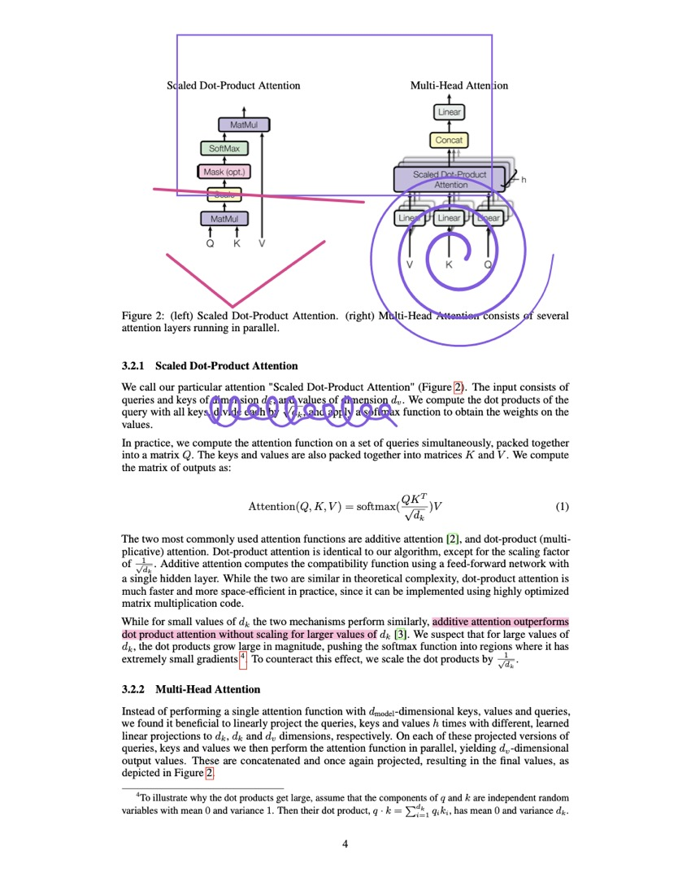

The original file is never changed: the copy is the original with the
annotations added after it. Exporting again replaces the earlier copy.
Encrypted PDFs cannot be exported this way; the reader says so.

### The PDF's own details

**Add the PDF's details to the note** (sidebar menu or command palette) reads
what the file records about itself (title, authors, year, DOI, subject,
keywords) and adds them as properties of the annotation note. Properties the
note already has are left alone, and nothing is looked up online. Export
templates can then use `{{title}}`, `{{author}}` and `{{year}}`.

### A PDF that was annotated in another program

PDF annotations are part of the PDF standard, so what Preview, Acrobat, a
tablet's note app or a reference manager put into a file can be read. When a
PDF holds such annotations the sidebar says so and offers to **take them in**
(also in the sidebar's menu and the command palette):

| In the PDF | Becomes |
| --- | --- |
| Highlight | A highlight of the words under it, in the nearest ink, with its comment as the note |
| Underline, strike-out, squiggly | The same, tagged `underline`, `strike-out` or `squiggly` |
| Rectangle, oval, text box | An area, with its text as the note |
| Sticky note | A small area at its spot, with its text as the note |
| Ink | A drawing |
| An answer to any of these | A reply |

From then on they are annotations like any other: edit, recolour, move, tag,
link and export them. They keep the date they were made.

- The PDF file is not changed, so its own copies stay visible on the page
  under yours. **Export PDF with annotations** writes a copy in which each is
  there once, as it is in your notes now; a passage tagged `underline`,
  `strike-out` or `squiggly` is written as that kind of mark.
- Taking in again adds only what is new in the file.
- Not taken: stamps, attached files, form fields, review states, and
  anything in an encrypted PDF. A mark over a scanned page (no text under
  it) comes in as an area.

## Books (EPUB)

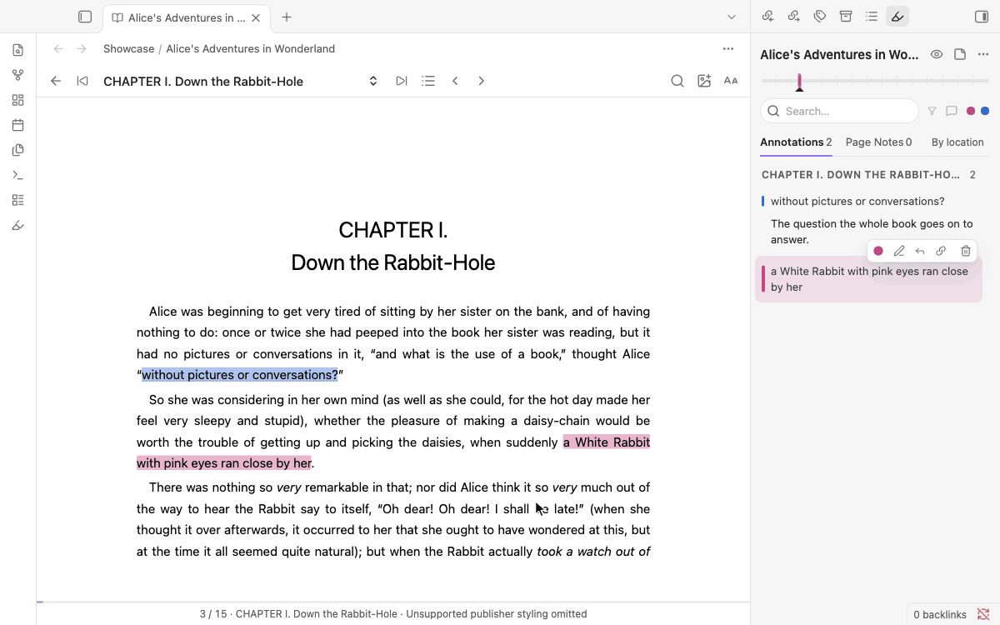

The bar has Back, the chapter with turns either side, **Contents**, page
turns, **Find**, **Keep a picture** and **Reading controls**.

- **Contents** lists the book's own table of contents, nested, with where you
  are and how many annotations each chapter holds.
- **Find** (`Ctrl/Cmd+F`) looks through the whole book and lists every match
  under its chapter; a result takes you there and selects the words.
- In the **Pages** layout a swipe turns one page, as does a tap at either
  side of the page; the arrows in the bar and the arrow keys do the same.
- **Reading controls**: page colour, text size, layout (Scroll or Pages),
  typeface, line spacing, column width and justification. Fixed-layout books
  keep the publisher's pages as they are.

- **Keep a picture with a note** (the picture button, or the *Mark an area*
  command): every picture on screen offers itself; click one, or Tab to it
  and press `Enter`. The picture's own file, as the book holds it, is saved
  as an attachment and leads the note; the kept picture is framed in its ink.
  What the book says about the picture (its description and caption) is kept
  with it, so it is found by search. A book's text has no fixed page, so it
  is the whole picture that is kept, not a rectangle; text in tables and
  captions is highlighted like any other text.

The thin line at the bottom is how far you are through the book.

## Videos and recordings

A note whose `annotation-target` is a YouTube link, or a video or audio file
in your vault, with `annotation-target-type: video`, opens as a player with
timed notes.

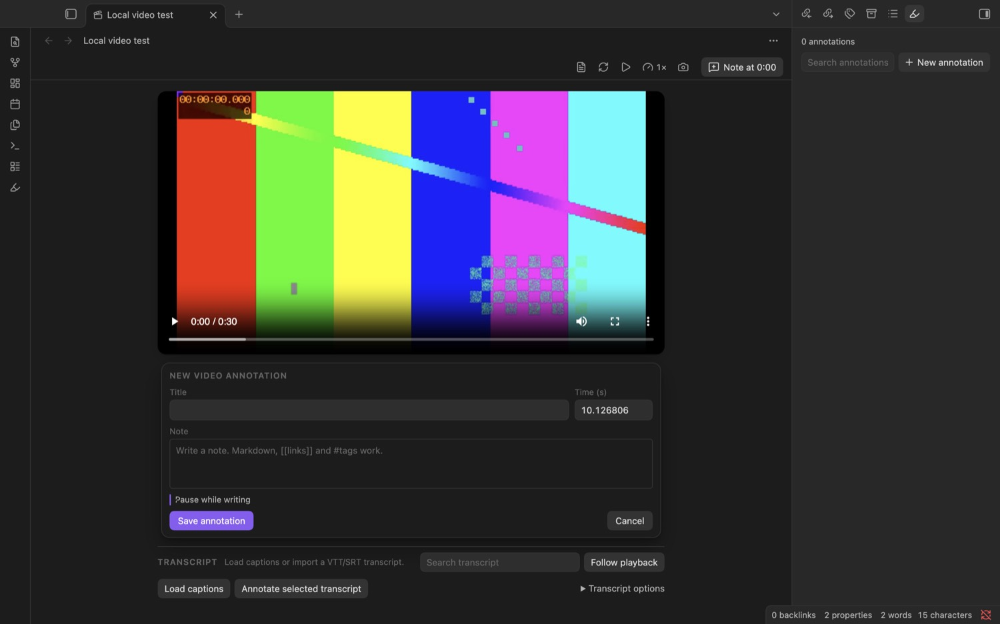

- **Note at 0:12** (or `N`) writes a note at the current moment, in a card
  under the picture. The video waits while you write; untick *Pause while
  writing* to keep it running.
- The camera button (or `S`) makes a **frame note**: the frame is frozen, you
  keep all of it or drag over a part, and the note opens with the picture.
  This reads the frame of a video file directly. For YouTube it pictures the
  player in the app's window, which only works on desktop; elsewhere you get
  a plain note at that moment.
- The timeline under the player has a marker for every note. `K` or `Space`
  plays and pauses, `J` and `L` skip ten seconds, the arrow keys five.
- Captions can be loaded or imported (VTT or SRT). Select words in the
  transcript and a bar offers **Highlight** (`H`: kept at once, at the time
  they are said) and **Note** (`A`: a note that quotes them). What your notes
  quote is marked in the transcript; a mark leads to its note.
- An audio file gets a slim player and everything else the same.

## Web pages

A web page is annotated where it lives: the real page, in Obsidian's own Web
viewer (a core plugin; desktop). Open a note whose `annotation-target` is a
web address, or run **Open website in core Web viewer**, and the page opens
with its annotations on it.

- **Highlights and notes.** Select text on the page; the bar offers the inks
  and **Note**. A highlight is painted in the page's own text and found again
  by its words when the page has changed around it. Click one to open its
  note.
- **Keep a picture with a note** (the picture button beside the address bar,
  or the *Mark an area* command): every picture on the page offers itself;
  click one, or Tab to it and press `Enter`; `Escape` leaves. What the Web
  viewer showed of the picture is saved as an attachment and leads the note,
  and the picture is framed in its ink on the page. It is found again by its
  place and by its address, and by its address alone if the page has moved
  it. Nothing is downloaded for this: the picture kept is what was on screen.
- **Nothing a page says is treated as an instruction.** The page can only
  offer a selection or a picture; what is saved is shown in Obsidian's own
  window first, and saving takes your click there. Your notes are never sent
  to the page.

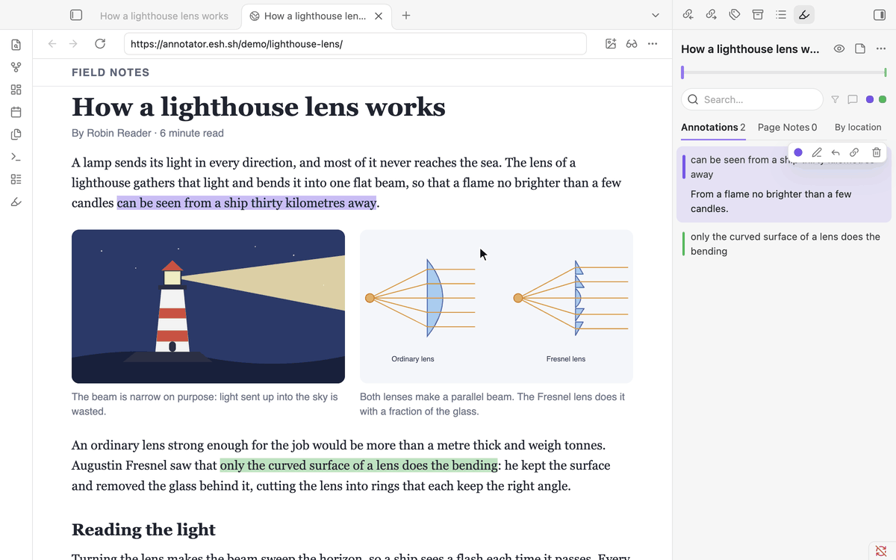

To try it, open the sample article at
`https://annotator.esh.sh/demo/lighthouse-lens/` in the Web viewer: it is the
page in the recording, and its text and pictures are free to reuse.

Where there is no Web viewer (phones and tablets) or no network, a **reading
copy** stands in: **Save website as an offline Markdown reading copy** keeps
the page's text as a note you can read and annotate anywhere, and the
annotations made on the live page show on it. A reading copy is text only: a
picture note is listed with its picture, but has no place on the copy.

An **HTML file in the vault** can be a source too: point a note's
`annotation-target` at it. The first time, a reading copy is made from the
file and kept beside it ("… (reading copy).md"); that copy is what you read
and annotate, offline, and it syncs with the vault. The HTML file is not
changed. A page saved from a browser keeps the address it came from.

## Sources outside the vault

A note may point at a file on the internet or elsewhere on your computer. The
first time, the reader asks, then downloads or copies it once into
`Annotator sources` in your vault and reads it from there. If that fails it
says why, and nothing is left behind.

A file on your computer is written as its full path, the way your system
writes it, or as a `file:` address:

| Written as | Example |
| --- | --- |
| A path on macOS or Linux | `annotation-target: /home/me/Papers/Attention.pdf` |
| A path on Windows | `annotation-target: C:\Users\me\Papers\Attention.pdf` |
| A file address | `annotation-target: file:///C:/Users/me/Papers/Attention.pdf` |

The key is `annotation-target`, spelled exactly so and without a colon of its
own: in Obsidian's Properties editor, type the name alone and the path as its
value.

## With Zotero

Zotero can stay your library while you annotate in Obsidian.

- **The PDF.** Zotero keeps each attachment in its data folder, under
  `storage`, in a folder with an eight-character name (in Zotero, right-click
  the PDF and choose **Show File**). Give that path as the note's
  `annotation-target`, for example
  `/Users/me/Zotero/storage/N7SMB24A/Attention.pdf`. The reader asks once,
  copies the file into `Annotator sources` and reads the copy; Zotero's file
  is never changed.
- **Highlights made in Zotero's own reader** are kept in Zotero's database,
  not in the PDF, so the file in `storage` does not carry them. Zotero can
  export a copy that does (**File → Export PDF…**). Put that copy in your
  vault and run **Take in the annotations this PDF already holds**.
- **The other way**, **Export PDF with annotations** writes a copy with your
  highlights as standard PDF annotations, which is the kind Zotero's reader
  shows for a PDF that has them.
- **Details.** **Add the PDF's details to the note** reads what the PDF
  records about itself. Nothing is read from Zotero's database.

The first point was tried on macOS with a folder laid out like Zotero's. The
exchange of highlights rests on both programs following the PDF standard and
has not been tried with Zotero itself.

## Reading progress

With **Keep reading progress in the note** on (settings; off by default),
leaving a PDF, book or video writes where you were to its annotation note as
the property `annotation-progress` ("12/340", "37%", "12:34"), so a list or a
Base can show what you are in the middle of. It is written once, on leaving.

The note travels with your vault, so the place does too: when a note says
something this device did not write, the source opens there (the page of a
PDF, the part of a book, the time in a recording). After that the device's
own place is the newer one again.

## Exporting notes

From the sidebar's menu:

- **Copy all as Markdown** and **Export to a summary note**: callouts, plain
  quotes, or your own template (`{{quoted}}`, `{{quote}}`, `{{note}}`,
  `{{image}}`, `{{kind}}`, `{{location}}`, `{{link}}`, `{{colour}}`,
  `{{tags}}`, `{{date}}`, `{{title}}`, `{{author}}`, `{{year}}`).
- **Export as individual notes + Base**: one note per annotation with
  properties, and a Base that lists them.
- **Export PDF with annotations** (PDFs).
- Hypothesis JSON, from the command palette, for other annotation tools.

## On phones and tablets

<p>
  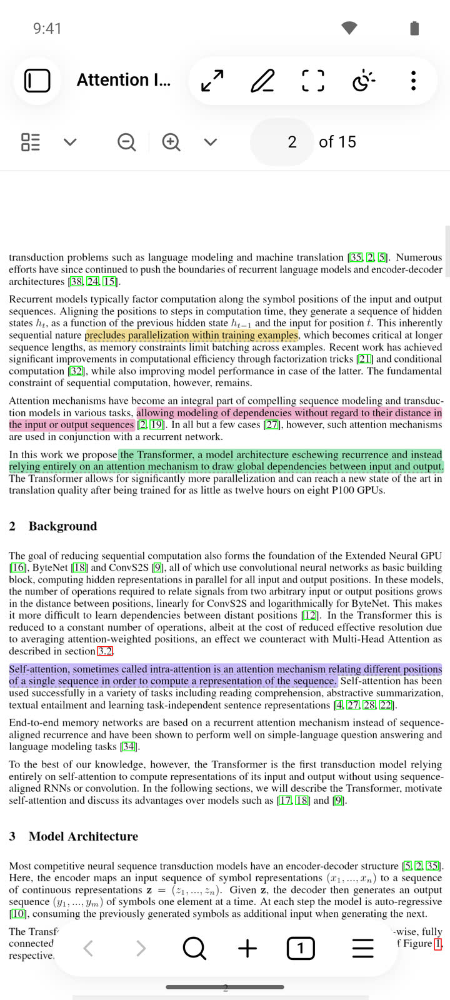
  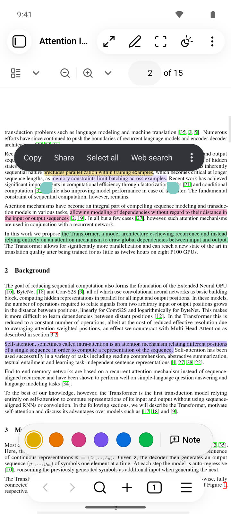
  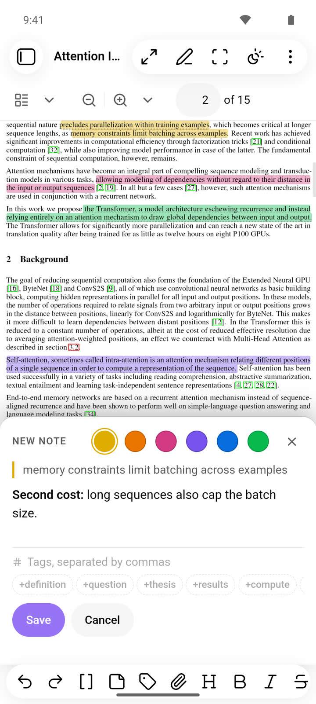
  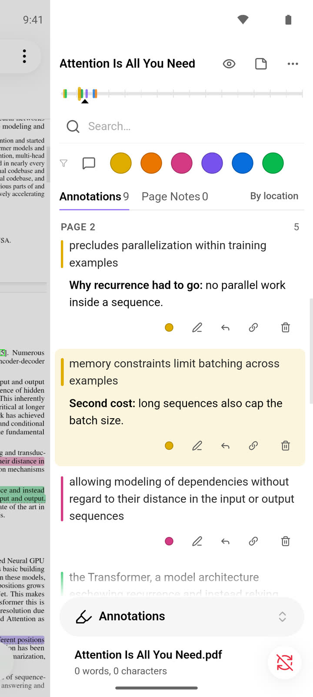
  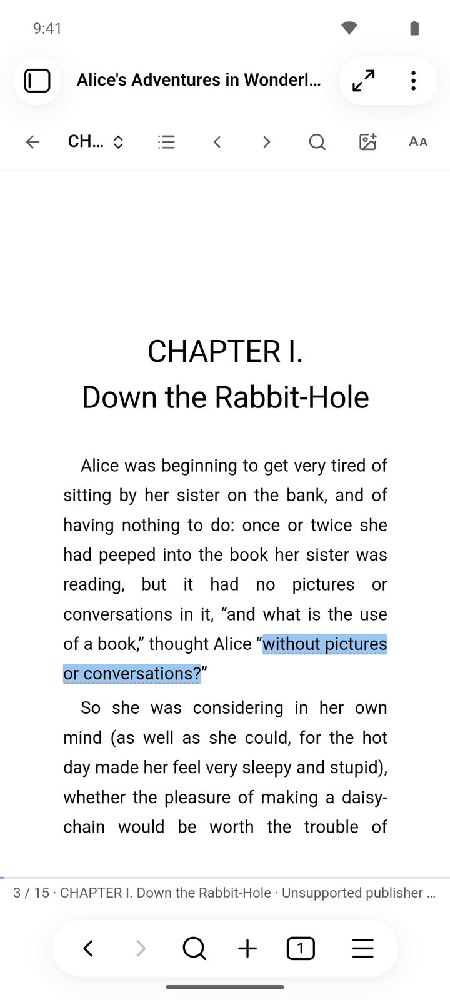
</p>

Obsidian for Android on a phone, left to right: a PDF with its highlights, a
selection with the bar, a note being written, the annotations in the right
drawer, and a book.

**Read full screen** (in the view's menu, or the command) hides the app's
header and navigation bar while you read; the small button at the bottom
corner brings them back, and they come back by themselves when you go to
something that is not a source.

Long-press to select; the bar with the inks and Note sits above the
navigation. A note is written in a sheet above the keyboard. Marking an area
and drawing work by touch. Page colours and a book's contents open as sheets
from the bottom. Opening a source shows the source: the annotations are in
the right drawer when you want them.

On a tablet there is room for both. The first time a source is opened with
the tablet held wide, the right drawer is docked beside the page with the
annotations in it; undock it and it stays undocked. A note is written beside
its passage, above the keyboard, and two sources can be open side by side,
each with its own annotations.

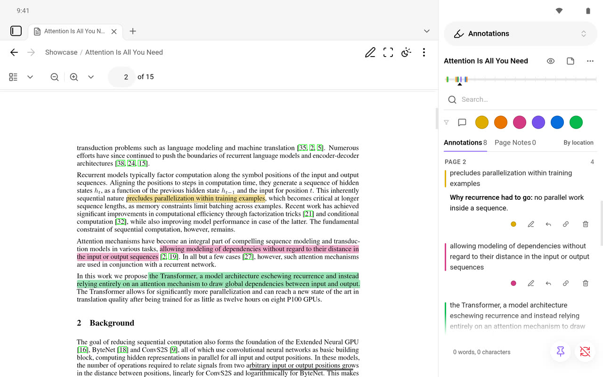

## Keyboard

| Where | Keys |
| --- | --- |
| Text selected | `H` highlight, `1`–`6` ink, `A` note |
| Writing a note | `Ctrl/Cmd+Enter` save, `Escape` cancel |
| Marking an area | `Enter` place or keep, arrows move, `Shift`+arrows resize, `Escape` leave |
| A saved area, focused | arrows move, `Shift`+arrows resize, `Alt` for fine steps |
| Drawing | `Enter` keep, `Ctrl/Cmd+Z` undo, `Escape` leave (asks once) |
| A saved drawing, focused | arrows move, `Alt` for fine steps, `Enter` open for changes |
| Book | `Ctrl/Cmd+F` find |
| Video | `K`/`Space` play, `J`/`L` ±10 s, arrows ±5 s, `N` note, `S` frame note |

Every command is in the command palette and can be given a hotkey.

## Making it yours

Highlights, cards and pages follow your theme. Colours, highlight strength,
the paper of the Sepia page and more are variables you can set from a CSS
snippet or the Style Settings plugin: see [STYLING.md](docs/STYLING.md).

## Coming from Annotator 0.2

Updating is all there is to do.

- **Your notes are not converted.** The annotation blocks in your notes are
  the format this version reads and writes. **Check annotation notes
  (migration)** in the command palette counts your annotated sources and
  highlights and lists anything that cannot be read; it changes nothing.
  One character differs in what is written from now on: the tags line of a
  new or edited annotation has a space after its quote mark (`> #tag`), so
  that every tag is clickable in Live Preview. Annotator 0.2 reads that
  line to the same tags, and blocks you do not edit stay as they are.
- **Your settings come along** at the first start: dark mode, the book's
  reading mode and text size, the default folder, the Markdown options and
  whether annotation notes open in the reader. The settings file and the
  workspace as they were are kept beside the plugin, in
  `native-upgrade-backup-v1.json`.
- **Tabs that were open** on an annotated source open again on it.
- **Switch between reader and Markdown note** is the same command, so its
  hotkey still works.

What you should notice, measured on the same vault ([how](docs/MEASUREMENTS.md)):

| | 0.2.11 | 0.3.0 |
| --- | ---: | ---: |
| Plugin files on disk | 26.3 MB | 1.5 MB |
| Enabling the plugin at each start, desktop | 1.1 s | 0.014 s |
| The same on an Android emulator | 6.0–8.6 s | 0.05–0.13 s |
| First highlight of an annotated PDF, Android emulator | 2.0–2.7 s | 0.9–1.4 s |
| The same on a desktop | 0.32–0.48 s | 0.40–0.43 s |
| Memory kept after closing a 7.6 MB PDF | 9.7 MB | 0.2 MB |

What is different:

- PDFs open in Obsidian's own PDF view, with the annotations in a sidebar that
  you can dock where you like. Books, web pages and videos each have their own
  view. Nothing is loaded from the Hypothesis client any more.
- A web page is read as a copy saved in your vault (or in Obsidian's Web
  viewer), not through a frame.
- Videos are annotated by time and by frame in the plugin itself; the
  annotate.tv setting of 0.2 is no longer used.
- Notes written here can hold things 0.2 did not have: areas, drawings,
  picture notes, annotations taken in from a PDF. Annotator 0.2 on another
  device still reads such a note.

## What is checked, and how

The rules that decide what is written into your notes (the annotation format,
creating, editing and deleting a block, reading a changed note in parts, the
geometry of areas and of lines drawn by hand) are written in Bend and proved
for every input; the proofs are checked on every build. The rest is tested:
over 600 tests of the reader,
and the PDF export is read back with two independent PDF readers. See
[proofs/README.md](proofs/README.md) and [SECURITY.md](docs/SECURITY.md).

## Limits to know about

- A highlight over a page break is shown by Annotator 0.2 (on a device not
  yet updated) on one page only.
- A frame of a paused YouTube video includes the player's own controls; take
  it while the video plays.
- Text in scanned PDFs is not recognised (no OCR).
- A PDF placed on a Canvas is shown without its highlights; open it in a tab
  to see and make them.
- Drawing is for PDFs; books have highlights, notes and picture notes, videos
  have notes and frame notes.
- A picture note in a book is not shown by Annotator 0.2 (it has no passage
  to anchor to there); the note itself is kept.
- iOS and iPadOS: the reader's own code has been run in iOS WebKit in the
  Simulator (selection, highlights, notes, drawing, books), not yet inside
  Obsidian for iOS on a device. YouTube may refuse to play there (its Error 153). The
  reader then says so and offers **Open in YouTube**; a note's time opens the
  video there at that time, and notes and the transcript work as before.

## If Obsidian adds PDF annotation of its own

PDF annotation is on Obsidian's public roadmap as planned (November 2026).
Nothing can be said yet about how it will work, so nothing is promised here about working
with it. What holds today: your annotations are Markdown in your own notes,
not in a database; **Export PDF with annotations** writes them into a copy of
the PDF as standard PDF annotations, which any program that follows the
standard reads; and **Take in the annotations this PDF already holds** reads
standard annotations another program wrote. Books, web pages and videos are
not PDFs and stay as they are.

## Contributing

[CONTRIBUTING.md](CONTRIBUTING.md) says how the repository is laid out and how
to build, test and check the proofs. Bugs, questions and suggestions are
welcome as [issues](https://github.com/elias-sundqvist/obsidian-annotator/issues).
What changed in each version is in [CHANGELOG.md](CHANGELOG.md).

## License

Annotator is licensed under the GNU AGPLv3: see [LICENSE.TXT](LICENSE.TXT).
The licences of the code it bundles are attached to each release.

## Support

If you want to support me and my work, you can
[sponsor me on GitHub](https://github.com/sponsors/elias-sundqvist) (preferred)
or donate on [PayPal](https://www.paypal.com/donate/?hosted_button_id=C5MBC9YBWTYEC).
