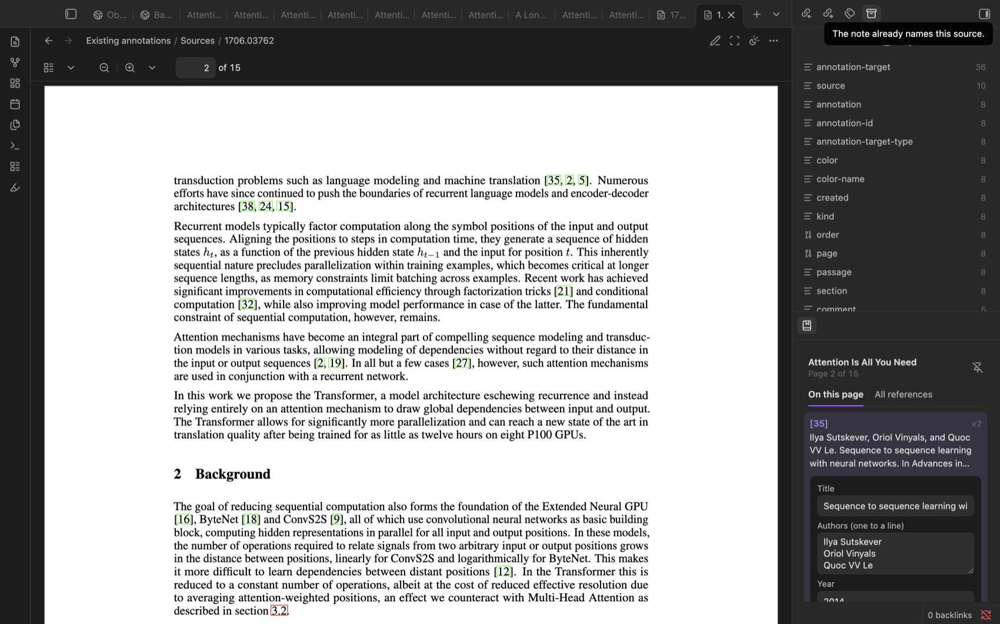

# Citations on the page in view: what was built and what was found

Written 2026-11-14. The design is [CITATIONS_DESIGN.md](CITATIONS_DESIGN.md);
this note says what the survey found, where the build differs from the
design and why, what was checked, and what was not.

## The survey

Before any constant was fixed, what Obsidian's PDF library (pdf.js 5.3.34 in
Obsidian 1.15.1) reports was recorded for 36 PDFs: 29 open-access papers
fetched for the purpose (kept out of the repository), the three LaTeX papers
and the scan of the test vault, and three papers set with Typst. The
recognition code was then run over all of them, with the checked logic
compiled from Bend, until what it said was right or was a plain "could
not".

Not reached: MDPI, Hindawi, RSC, the Royal Society, OUP, BMJ, JMIR,
Elsevier, Wiley, IEEE, ACS and Science refuse a plain client, and so does
Europe PMC's PDF renderer. Their PDFs were not tried. Elsevier's and Wiley's
are the largest gap.

"Works" counts rows that name a work, over every page of the PDF. "L" is a
labelled list, "u" one without labels; "~" a list found by where links land
because it has no heading.

| PDF | Made with | Destinations | List (pages: entries) | Works | Several fit | Conflict | Not found | Linked, not read |
| --- | --- | --- | --- | ---: | ---: | ---: | ---: | ---: |
| ACL 2020 (author–year, two columns) | pdfTeX, hyperref | point | 5–6: 23 u | 26 | 0 | 0 | 0 | 0 |
| arXiv 1312.6114 (letter labels) | pdfTeX, hyperref | point | 9: 17 L | 21 | 0 | 0 | 0 | 0 |
| arXiv 1404.7828 (88 pages, author–year) | pdfTeX, hyperref | point | 35–88: 888 u | 1019 | 9 | 3 | 6 | 34 |
| arXiv 1412.6980 (author–year, no links) | pdfTeX | none | 10–12: 25 u | 28 | 3 | 0 | 0 | 0 |
| arXiv 1505.04597 (LNCS, `1.` labels) | pdfTeX, hyperref | point | 8: 14 L | 19 | 0 | 0 | 0 | 1 |
| arXiv 1512.03385 (two columns) | pdfTeX, hyperref | point | 9: 50 L | 96 | 0 | 0 | 0 | 0 |
| arXiv 1602.03837 (PRL, no heading) | Acrobat Distiller | point | 9–11~: 118 L | 123 | 0 | 0 | 0 | 0 |
| arXiv 1810.04805 (author–year) | pdfTeX, hyperref | point | 10–12: 56 u | 84 | 0 | 0 | 0 | 0 |
| arXiv 2010.11929 (author–year) | pdfTeX, hyperref | point | 9–13: 61 u | 85 | 0 | 0 | 0 | 5 |
| arXiv math/0211159 (letter labels, no links) | dvips, Ghostscript | none | 38–39: 27 L | 27 | 0 | 0 | 0 | 0 |
| arXiv, Word printed through Ghostscript | Ghostscript | none | refused | 0 | 0 | 0 | 0 | 0 |
| arXiv, Word (author–year, no links) | Microsoft Word | none | 24–28: 34 u | 32 | 1 | 0 | 0 | 0 |
| Copernicus GMD (author–year, no citation links) | pdfTeX | point | 12–14: 49 u | 69 | 0 | 0 | 0 | 0 |
| JMLR (author–year) | pdfTeX, hyperref | point | 28–30: 36 u | 59 | 0 | 0 | 0 | 0 |
| PMLR (author–year, printed, no links) | PDFium | none | 9–16: 151 u | 94 | 0 | 0 | 0 | 0 |
| BMC Bioinformatics | InDesign | point | 18–20: 55 L | 64 | 0 | 1 | 0 | 0 |
| Communications Biology (raised numbers) | iText | box | 15–16: 66 L | 72 | 0 | 0 | 0 | 0 |
| eLife (author–year) | InDesign | point | 19–22: 71 u | 107 | 0 | 2 | 2 | 6 |
| Eur. Phys. J. C (one-line entries) | Springer | point | 3: 8 L | 9 | 0 | 1 | 0 | 0 |
| Frontiers in Psychology (author–year, first lines indented) | InDesign | point | 17–19: 99 u | 149 | 0 | 0 | 1 | 1 |
| Genome Biology | InDesign | point | 24–27: 91 L | 108 | 0 | 0 | 0 | 0 |
| J. Cheminformatics | Acrobat Distiller | point | 12–13: 37 L | 48 | 0 | 0 | 0 | 0 |
| JHEP (heading not found as a line) | LaTeX, hyperref | point | 23–29~: 123 L | 186 | 0 | 0 | 0 | 0 |
| Nature Communications (raised numbers) | iText | box | 7–9: 73 L | 77 | 0 | 0 | 0 | 0 |
| Nature (raised numbers, no heading) | Springer | point | 6–7~: 30 L | 37 | 0 | 0 | 0 | 0 |
| PLOS Computational Biology | Arbortext | box | 25–28: 52 L | 71 | 0 | 0 | 0 | 0 |
| PLOS ONE | Arbortext | box | 12–15: 58 L | 54 | 0 | 0 | 0 | 0 |
| Scientific Reports (raised numbers) | Adobe PDF Library | point | 12: 38 L | 59 | 0 | 0 | 0 | 0 |
| Springer open-access book (388 pages, a list per chapter) | Adobe PDF Library | point | 13 of 17 lists read, 442 entries | 496 | 0 | 1 | 10 | 44 |
| Typst, author–year | Typst | point | 2: 3 u | 3 | 0 | 0 | 0 | 0 |
| Typst, numbered | Typst | point | 2: 3 L | 3 | 0 | 0 | 0 | 0 |
| Typst, raised numbers | Typst | point | 2: 3 L | 3 | 0 | 0 | 0 | 1 |
| Test vault: 1706.03762 | pdfTeX, hyperref | point | 10–12: 40 L | 58 | 0 | 0 | 0 | 0 |
| Test vault: 2103.06435 (ACM, two columns) | pdfTeX, hyperref | point | 8: 40 L | 46 | 0 | 0 | 0 | 0 |
| Test vault: 2109.01394 | pdfTeX, hyperref | point | 10–12: 54 L | 68 | 0 | 0 | 0 | 0 |
| Test vault: a scan | macOS | none | no text | 0 | 0 | 0 | 0 | 0 |

The rows named were looked at by eye for a page or two of each kind (linked
and unlinked, labelled and not); they were right there. They were not all
checked one by one: nobody has confirmed all 1,019 rows of the 88-page
survey paper. Where the PDF links its citations, the count of rows whose
link and words agree is the check there is.

What the survey changed:

- **Where a link lands differs by who made the PDF.** LaTeX puts the point
  at the top of the entry's first line (1.0 to 1.7 line heights above its
  baseline); several publishers put it on the baseline; three give a box
  whose left edge is the page's, or a box that says nothing useful (PLOS).
  One fixed window, as the design had it, would have been wrong for half of
  them. So a link's landing is **measured against the page itself**: the
  other links on the page (and on pages read before) whose words name one
  entry each say how far above an entry this PDF's links land; a link is
  believed where it lands at that distance from exactly one entry, and only
  if at least two others agree and none disagrees. A PDF whose links land
  nowhere useful fails this and its citations are named by their words.
- **A list is not divided by where links land** (the design's second way).
  Landing points mean nothing until they are measured against entries, and
  entries are what dividing makes. Lists are divided by labels or by
  layout, as the survey's lists all could be.
- **Author–year lists are sorted by surname**, not by first word, where
  given names come first; and by the first author as written ("Van de Poel"
  under V) where surnames do. The order check uses that.
- **A place inside a text run is estimated by the usual widths of letters**,
  with what a justified line is wider than that given to its spaces. Counting
  characters, as first written, put a number in a justified line several
  letters away from its link.
- **A link to the first entry may land as high as the list's heading**
  (Typst), and a book sets one running head on left pages and another on
  right ones.

## Where the build differs from the design

| Design | Built | Why |
| --- | --- | --- |
| A link lands on the entry whose first line is in a fixed window below it; links are trusted when two on the page agree with the text. | The distance is measured per page (above); pages read before count too. | The survey. It makes what a row says depend, a little, on which pages were looked at first: a row may say "matched by its number" on one visit and "linked in the PDF" on the next. It never changes which work is named. |
| Lists divided by labels, by landing points, or by layout. | By labels or by layout. | Above. |
| "The reference list was read up to entry 37; this page cites up to 52." | Not said. A bracket with a number the list does not have is not taken for a citation at all. | Saying it needs brackets to be read without the list's labels, which is what lets `t ∈ [1, 2]` in. Missing numbers inside the list are said. |
| A list that cannot be divided: citations are listed as written, without their works. | The status line says the list could not be divided; links into it are still listed as "Linked to the reference list". | Without entries there are no labels to tell a citation from any bracket. |
| No timer and no listener while the view is not showing. | No listener on the vault; one timer that only looks whether the view is showing, as the Annotations sidebar has. | Obsidian tells a view nothing when it is hidden. |
| `cite_name_stable` (naming a name gives the same name). | Not proved; left out of the laws. | It needs five more lemmas for little use: the form shows the name it will write. |
| Laws over a page's text. | Laws over short values: the inside of one bracket as tokens, keys as numbers. Finding brackets and numbering strings is TypeScript. | A recursion over a page overflows the stack; and positions in a text stay JavaScript's. Measured: the checked functions take lists of 6,000 and refuse above 5,000; deciding 60 citations against 400 entries takes under 3 ms. |
| Each name-and-year that fits nothing is counted at the foot. | So built; where the list is linked, wordings no link lies over are not counted at all. | They are not citations of that list. |

The laws as proved are in [proofs/README.md](../../proofs/README.md) under
"Citations": 61 laws, 26 deliberately broken programs refused.

## What was checked

- **Proofs:** `npm run proofs` passes: all proofs check, the kernel accepts
  them a second time, every broken program is refused, the bridge tests
  pass.
- **Tests:** 33 new ones, in `test/citations.test.mjs` (20: lists,
  citations, the rule, refusals, the form's proposals, cost),
  `test/citations-view.test.mjs` (12: the view, the form, the note, what
  it costs hidden) and `test/native-pdf-lifecycle.test.mjs` (1: an opened
  PDF is asked for nothing more until its citations are asked for). They
  run on what the PDF library reports for six PDFs, frozen beside them:
  three papers written for the tests and three published under CC BY
  (`test/support/fixtures/citations/README.md`). The whole reader suite
  passes (627), with lint and the format check.
- **In Obsidian 1.15.1 on macOS,** on the test vault's 1706.03762: the view
  opens in its own part of the right sidebar and follows the theme; page 2
  lists its 20 works in order, 19 of them "Linked in the PDF"; **Show on the
  page** flashes the citation; **Go to the entry** goes to page 12, flashes
  the entry and marks it among the page's entries, and the reader's Back
  returns; the form proposes title, authors, year and name; **Create**
  makes a note of properties only, linked back to the source's note, and
  the row then links to it; a second note of the same name is refused;
  linking an already linked note says so and writes nothing.

  

## What was not tried

- A phone or a tablet, and Windows or Linux. The phone path (the drawer is
  put away before a citation is shown) is tested with a stand-in only.
- The command that makes a note from selected text, in a running Obsidian
  (its form is tested).
- A PDF larger than the 388-page book (0.3 s of the logic for all its
  pages, outside Obsidian).
- The publishers listed above; a scan with recognised text; a list in a
  right-to-left script or in Chinese; a thesis.
- A vault with tens of thousands of notes (the index of notes is one pass
  over the metadata cache).

## Known weak spots

- **Keys read from entries.** Which word is the surname and which year is
  the year is read by rules of style. Where that goes wrong a row says "not
  found" or "several fit"; if the right entry was lost and another fits
  alone, that other is named. The order check and the links are what stand
  against it.
- **A range inside a bracket whose numbers are linked one by one** can
  attach a link to its neighbour (one conflict each in three survey PDFs).
- **Lists the survey refused:** a Word paper printed through Ghostscript
  (lines come out in an order no rule here sorts), and four of the book's
  seventeen chapter lists (entries sorted in ways the order check does not
  know).
- **`Several fit` for "Graves, 2013" beside "Graves et al., 2013":** that
  "et al." means more than one author is not used.
- **Hyphens at line ends** stay in the reference as shown and in the title
  proposed; the form is where they are taken out.
