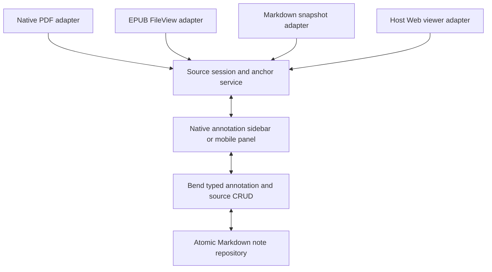

# Native EPUB and website annotation plan

Status: proposed implementation, researched 2026-10-30. Based on native PDF
commit `5dc91d6`, on `experiment/obsidian-native-pdf`. This document adds no
reader code, changes no existing annotations and requires no unlocked Mac.

## Hard requirement: Hypothesis cross-compatibility

The native readers and the embedded Hypothesis client must support ongoing
bidirectional CRUD on the same annotations, including alternating readers. Existing Markdown notes open in place without mandatory migration;
new native locators are additive. Hypothesis JSON exchange needs a separate
lossless import/export boundary because local write defaults omit identity data.
Data preservation, locating the original passage and alternating bidirectional
CRUD are separate release gates. Importing old notes alone does not satisfy this. See [HYPOTHESIS_COMPATIBILITY.md](HYPOTHESIS_COMPATIBILITY.md)
for scope, field/ID preservation, fixture requirements and current gaps.
[INTEROPERABILITY_RESULTS.md](INTEROPERABILITY_RESULTS.md) records the implemented
shared-store layer; EPUB/web rendering and differential anchoring remain future
adapter work.

## Recommended product direction

Use one Obsidian annotation UI and one Bend-backed Markdown repository, with
small source-specific reading/anchoring adapters.

| Source | Recommended reading surface | Portability |
| --- | --- | --- |
| PDF | Existing built-in PDF view + our overlays | Existing prototype is desktop-only; mobile needs host testing |
| EPUB | An Obsidian FileView rendering sanitized, reflowable chapter content with native controls | Design for desktop/mobile using vault binary APIs; test both |
| Saved web article | A Markdown snapshot opened in Obsidian's ordinary reading/editor views | Preferred offline/mobile path |
| Live website | Extend the existing core Web viewer, keeping comments in our native sidebar | Desktop feature, with snapshot/external-browser fallback |

EPUB should feel like an Obsidian book tab: theme/font controls, chapter outline,
search, footnote popovers, reading progress and the same annotation sidebar as
PDF. Preserve the original EPUB rather than requiring a lossy Markdown conversion.
An optional chapter-to-Markdown import can provide editable notes and backlinks.

For websites, offer **Read live** and **Save a reading copy**. Snapshots give us
stable text and Obsidian's actual editor. Live pages retain interactive behavior,
but annotation support must tolerate navigation and changing content.

The important boundary: removing our iframe/Hypothesis machinery is feasible.
Rendering arbitrary live websites inside Obsidian still needs the host's browser
isolation. Electron documents webview as a separate guest process and internally
an out-of-process iframe. We must not describe the live-web path as literally
having no frames, or insert active website HTML into Obsidian's privileged DOM.
Reuse the host Web viewer rather than creating another browser container.
[Obsidian Web viewer](https://obsidian.md/help/plugins/web-viewer),
[Electron webview implementation](https://www.electronjs.org/docs/latest/api/webview-tag#internal-implementation).

## Evidence and reuse candidates

These are source inspections, not claims of host-tested compatibility. Pinned
revisions and source entry points are recorded in [epub-web-research.json](epub-web-research.json).

- Obsidian's [supported formats](https://obsidian.md/help/Files%2Band%2Bfolders/Accepted%2Bfile%2Bformats)
  include PDF but not EPUB; a plugin reading surface is needed for EPUB.
- [Leaf Reader](https://github.com/wanderxuhq/leaf-reader/tree/0c9f36010a283e021613aac7e5d36a45a5a85ded)
  demonstrates a chapter-based FileView, direct chapter DOM, resource processing,
  range highlights and navigation. Its own LBP locator is **not EPUB CFI**.
  Its architecture notes warn of incompatible earlier formats and browser-mocked,
  rather than completed mobile host, testing. Reuse selected parsing/lifecycle
  ideas, not its note format or sanitizer without review.
- [Epub Importer](https://github.com/aoout/obsidian-epub-importer/tree/1b69198c636c8d2dea7523edbf309c1b1e81d76c)
  is a useful reference for OPF/NAV/NCX handling, chapter splitting, assets and
  HTML-to-Markdown conversion. Its current archive reader has a Node filesystem
  path, so importing the whole plugin would not establish mobile compatibility.
- Official [Obsidian Web Clipper](https://github.com/obsidianmd/obsidian-clipper/tree/6d56d618b00bd970aa738d6a7a61edee27783e81)
  has text/element highlights, XPath, offsets, quote context and grouped
  multi-block selections. Inspect its extraction/highlighter tests and import
  adapter possibilities. Browser-extension storage is not our vault repository:
  do not promise automatic two-way synchronization. Its code license is MIT;
  branding/marketing assets are excluded.
- [Dark Reader for Web Viewer](https://github.com/DuckTapeKiller/dark-reader-web-viewer/tree/f14338a7139349bdfab99deee16fedc69840e035)
  demonstrates discovering native `webviewer` leaves, guarded executeJavaScript,
  dom-ready/navigation events and cleanup. It is a lifecycle reference, not an
  annotation engine or a public Obsidian API guarantee.

The three other repositories above also have MIT license files. Preserve notices
for extracted code and review transitive licenses. Our repository remains AGPLv3;
no external implementation is copied by this planning change.

The original integration is also evidence:
`src/defineEpubAnnotation.tsx` wraps epub.js in GenericAnnotation, uses `?loc=`
chapter addresses, and creates CFIs for navigation. That does **not** establish
that saved annotation JSON contains CFIs. `src/defineWebAnnotation.tsx` injects
the Hypothesis client into its iframe. Both implementations can be replaced at
the reader boundary without replacing the annotation Markdown format.

## Shared architecture to extract from the PDF prototype

Extract the sidebar, note association, comment editing and conflict checks from
main.ts. Keep native-pdf.ts as one adapter. Generalize labels and capability
handling instead of making EPUB/web code impersonate a PDF page. Leave the
shipping plugin's default view routing alone during these experiments.

A source session needs an identity, content revision, projection version,
navigation generation, selection snapshot and disposal/cancellation scope.
An adapter supplies capture, resolve, paint, navigate and cleanup. Capability
flags distinguish single-part/multi-part selection, live navigation and editing.
Unsupported actions must refuse explicitly rather than save only part of a
selection. All source types share Markdown-rendered comments, IDs and list UI.

Register an EPUB view for .epub files. Use public workspace/file lifecycle APIs
and ordinary Markdown views where available. Do not register a replacement for
all .md files or automatically hijack unrelated notes. Opening the annotation
note as plain Markdown must always remain available. Offer a compact native
sheet/panel on mobile rather than relying on a permanently wide desktop sidebar.

### Locator/data contract before implementation

Keep existing annotation IDs, selectors, unknown fields and source strings.
Add a versioned, typed native locator alongside them, not an incompatible new
storage backend. The following are conceptual variants, **not a decided wire
schema or already-implemented Bend datatypes**:

| Variant | Required scope and hints |
| --- | --- |
| EPUB | Publication identity/revision, original resource href, projection version, quote/context, resource-local UTF-16 range; optional original-DOM CFI |
| Live web | Actual URL identity, captured content revision, projection version, quote/context; original DOM range/XPath as a hint |
| Markdown snapshot | Snapshot file identity/revision, original URL provenance, source/rendered projection mapping and quote/context |

The current nativePdf v1 extension must remain readable. New locators should be
per target so future multi-resource selections need not overload one global
page/chapter field. Unknown versions remain preserved and visibly unsupported;
malformed known versions fail before writing. Specify the exact wire schema and
Bend sum types before emitting these new fields.

Do not mix PDF document-wide offsets, EPUB resource-local offsets, XPath/CFI
positions, Markdown source positions and rendered-text positions. Each must name
its coordinate space and version. New native offsets can have validated bounds;
do not retroactively impose those restrictions on every legacy JSON number.

## EPUB implementation

### Reading surface

Start with DRM-free, reflowable EPUB 2/3: read bytes through Vault.readBinary,
parse ZIP/container/OPF, resolve manifest/spine and NAV/NCX, and display chapter
content in an Obsidian FileView. Use bounded parsing/resource budgets and lazy
current/neighbor chapter loading. Normalize archive-relative references within
the archive root; legitimate ../Images links must work without escaping it.
Revoke resource URLs and cancel stale chapter loads on close or file switch.

Default to Obsidian fonts, colors and spacing. Preserve useful headings, tables,
images, ruby, direction/language and footnotes. Render an accessible outline and
normal back/forward navigation. Begin with scrolling; pagination can follow
without changing saved anchors or progress into layout-dependent page numbers.

Treat book XHTML as inert content. Strip active elements/handlers and dangerous
URLs; resolve assets to controlled local resources. Scope styles through a
reviewed mechanism, potentially Shadow DOM with a constrained style policy.
**Shadow DOM is CSS encapsulation, not a security sandbox.** Do not carry forward
the current allowScriptedContent:true setting. Scripted EPUBs, DRM, fixed layout
and complex multimedia need separate support decisions and clear diagnostics.
[EPUB format scope](https://www.w3.org/TR/epub-33/).

### Anchoring and compatibility

Build one retained-text projection used by search, selection, progress and
annotation resolution. Keep mappings from inert original XHTML nodes to retained
rendered nodes, including entity decoding, removed nodes and inserted wrappers.
Resolve a CFI against the original document tree first, then map it into the
reader; a path into the post-sanitization tree is not automatically a valid CFI.
CFI character offsets use UTF-16 units.
[CFI specification](https://w3c.github.io/epub-specs/epub33/epubcfi/).

Use publication + resource href as scope, CFI/position as hints, and verified
quote/context as fallback. Package identifiers and spine indices alone are not
sufficient identity across editions. Show unmatched/ambiguous notes in the list.
Font, theme, viewport and pagination changes must not change logical anchors.

Before claiming legacy compatibility, capture a real annotation from the pinned
Hypothesis client on a synthetic EPUB. Record its full request/response and note
bytes, including uri, target.source, selectors and ?loc= encoding. We currently
lack a confirmed EPUB annotation fixture. Preserve those fields; do not guess
that epub.js navigation CFIs are the saved annotation contract. Import conversion
must be explicit, and opening a book must never rewrite old selectors.

Optional Markdown import should create derived chapter notes/assets with links
back to the original book. Treat conversion as potentially lossy, preserve its
source map/version and expose unsupported content. It is not a round-trip codec
for the original EPUB, nor a prerequisite to reading and highlighting the book.

## Website implementation

### Native reading copies: first reliable web deliverable

First test the core Web viewer's own Reader view and Save to vault actions.
If the resulting notes meet our Markdown/provenance requirements, attach our
annotation UI directly to them. Add a dedicated importer only where needed;
do not assume those native buttons expose a stable programmatic API.
[Core reading and saving actions](https://obsidian.md/help/plugins/web-viewer).

Import selected articles into Markdown snapshots with original URL, title,
capture time and content/projection revision. Prefer reuse of official Clipper
extraction/conversion components where their runtime and licenses fit. Keep an
optional sanitized HTML representation if exact article structure is needed.
Opening a URL must not silently create files or refresh an existing saved copy.

Read the snapshot in the real MarkdownView. Add CodeMirror decorations for
editor/Live Preview and mapped highlights in Reading view. Keep annotations in
a separate associated Markdown note so annotation CRUD never has to reserialize
the imported article. Do not insert nested == markers on every highlight cycle.

Markdown source and rendered text differ around emphasis, links, embeds,
footnotes and code. Implement a tested source/rendered range map; source offsets
must not be mislabeled as offsets in extracted article text. Existing native
highlights authored directly in a note remain distinct from our owned overlays.

Refreshing an article creates a new explicit content revision and attempts
reanchoring. Unresolved annotations retain the prior snapshot/provenance; never
destructively replace the only old text. A live page and its simplified/clipped
copy have related provenance, not automatically identical coordinate spaces.
This path is the mobile/offline default.

### Live pages: extend the host, not a second browser

Probe the core Web viewer on the tested Obsidian version: native leaf discovery,
actual URL, guest document lifecycle and supported script execution. Keep all
private integration behind one capability-checked adapter. The current Mac is
locked, so this host capability probe is a planned gate, not a completed test.

Install a small, versioned page agent for text selection, range resolution,
painting and scrolling only. A range-based CSS Custom Highlight API can avoid
wrapping site text; use a tested overlay fallback and separate hit testing for
clicks/overlaps. Keep the comment editor and annotation repository in Obsidian.
Do not send private comment text, vault paths or vault APIs into the page agent.

Start with an explicit native Capture selection command. The agent can cache
selection before focus moves to the sidebar; retrieve bounded serialized data
through the existing guest API. A limited active-mode polling path is an option
if the host provides no safe event channel. Do not assume ordinary host DOM
selection events cross the guest boundary or invent a public two-way bridge.

Every response carries a source session/navigation generation. The host checks
its authoritative current URL and known annotation IDs; saves remain explicit
native UI actions. Discard stale replies after reload, redirects, SPA navigation
or tab replacement. Limit indexing to a defined content root and surface changed
or ambiguous anchors instead of guessing. Preserve original/canonical URL
provenance; do not merge different query-string URLs indiscriminately.

No browser-debugging port, exposed local server, altered CSP/Node integration,
or replacement preload is required or planned. Guest pages must never be given
a generic execute/write-file command. Cross-origin frames, inaccessible shadow
roots and canvas-only content are unsupported until a specific safe adapter is
designed. Use a snapshot or official browser Clipper workflow as fallback.

Live Web viewer is desktop-only according to the official docs. On phones,
EPUBs and saved Markdown should use Obsidian directly; live browsing can stay in
the system browser with an optional Clipper import path where supported. A
browser extension is a separate product/integration, not something our plugin
can silently install or promise to keep synchronized.
[Official highlighter behavior](https://obsidian.md/help/web-clipper/highlight).

## Work sequence and completion gates

| Milestone | Deliverable | Gate before moving on |
| --- | --- | --- |
| 1. Shared source session | Extract native UI/repository + adapter capabilities; specify versioned locator types | Existing PDF behavior and all current proofs/tests preserved; stale source actions refused |
| 2. EPUB vertical slice | Open synthetic book, navigate two chapters, select/save/reopen a highlight | No plugin-owned iframe or active book script; original archive unchanged; resources cleaned up |
| 3. EPUB compatibility | Real pinned-client fixture, original-tree CFI mapping, quote fallback, progress/search | Legacy notes open in place; original and native-written annotations reopen correctly in supported old readers; reflow/duplicates verified |
| 4. Native web snapshot | Import one article, annotate in native editor/Reading view, retain revisions | Rich Markdown mapping verified; source article unchanged by CRUD; offline reopen works |
| 5. Host live-web probe | Bind existing Web viewer + bounded capture/paint agent | Navigation cancellation and read/capture/restore demonstrated in the actual host; no new privileged bridge |
| 6. Live web annotations | Shared native UI, source association, snapshot fallback | Dynamic content, duplicate quotes and normal navigation tested; comments stay in native UI |
| 7. Mobile/production gate | EPUB + snapshot host testing, accessibility, scale and lifecycle | Real iOS/Android evidence; keep current desktop-only manifest until supported capabilities are established |

EPUB and snapshot work are independently useful; live-web integration must not
block offline reading. No time estimates are implied by these milestones.

### Test/proof plan

The [Hypothesis compatibility corpus](HYPOTHESIS_COMPATIBILITY.md#compatibility-corpus-and-release-gate)
is mandatory for each source adapter and for the planned JSON exchange boundary.

Use a small synthetic EPUB corpus and controlled local web fixtures before
real-world samples. Cover book resource links, non-linear footnotes, CJK/ruby,
RTL, emoji, ligatures, text removal, duplicate quotes, font/width changes and
large chapter cancellation. For web, test delayed text, SPA URL changes,
navigation during capture/save, article refresh, canonical/query distinctions
and native Markdown source/rendered mapping. Include two tabs and pop-outs.

Reuse all existing Bend laws and add checked locator/schema round trips when
new datatypes are implemented. Useful additional conditional laws are: retained
text mapping round trips for representable ranges; accepted match implies a
verified quote/context in the named source; rejected/stale operations preserve
the annotation document; and note boundary normalization remains idempotent
across all source adapters. Include successful witnesses so rejection-only
implementations cannot pass the gates vacuously.

Do not claim sanitization/conversion is lossless or that normalization has an
inverse for removed text. Preserve original resources and model partial mappings.
Web navigation, guest messages, browser geometry, XML/ZIP libraries and actual
vault writes remain tested host boundaries unless separately modeled/proved.
No theorem can guarantee a changing remote page retains the same passage.

## Decisions still to validate

- Exact legacy EPUB wire representation and the new typed locator schema.
- The best audited chapter sanitizer/style policy and EPUB CFI implementation.
- Native Markdown mapping coverage and the snapshot extraction runtime boundary.
- Which host Web viewer bridge capabilities actually work without changing its
  isolation or session setup.
- Whether browser-extension import should remain one-way or become a separately
  specified synchronization feature.

These are implementation gates, not reasons to postpone the EPUB vertical slice
or the shared-native-UI work. All reader/data migrations remain opt-in until
round-trip compatibility and actual host evidence are available.
