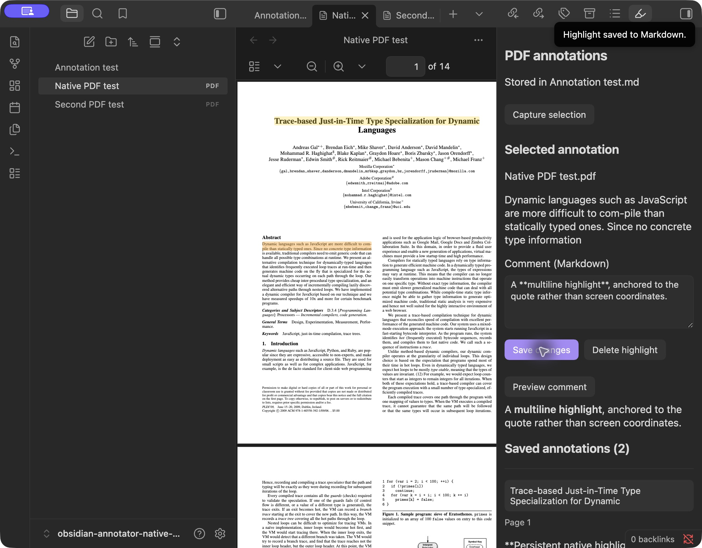

# Persistent native PDF highlights: implementation and live evidence

Historical v0.0.2 evidence. For the newer v0.0.3 implementation and its pending
live checks, see [INTEROPERABILITY_RESULTS.md](INTEROPERABILITY_RESULTS.md).

Implemented on `experiment/obsidian-native-pdf`, based on `bb225d3`.
Tested 2026-10-30 with Obsidian **1.13.7**, macOS **26.6.2**, Node **26.10.0**,
and Bend **2.0.5**. This is the separate prototype plugin, version **0.0.2**;
the production Annotator plugin is unchanged.

## Working behavior

Native PDF text selections now produce persistent annotations, not merely
browser selection color. An explicit save writes an annotation block to the
associated Markdown note through the ahead-of-time compiled typed Bend codec.
The reader clears its native selection after saving; the annotation overlay
stays painted. Clicking a painted highlight opens the saved comment. Markdown
comments can be edited, and annotation deletion removes the corresponding mark.

The native adapter indexes the host document's text across all pages, verifies
position hints against quote/context, and reanchors unique quote/context matches
when positions differ. It constructs live DOM Ranges for painted pages and
recomputes page-relative rectangles after layout/text-layer changes. It stores
no screen coordinates and does not modify the PDF.

The new `nativePdf` extension has version 1, a page hint and the unit name
`document-utf16`. The actual selectors remain TextQuoteSelector plus a
document-wide UTF-16 TextPositionSelector. The annotation schema and unknown
extensions continue to pass through the typed Bend model.

## Live test observations

The isolated vault is `~/Documents/obsidian-annotator-native-test`.
It contains the public PDF.js example already bundled in the repository, copied
under two different file paths. Existing personal vaults were not used.

| Check | Observed result | Original screenshot |
| --- | --- | --- |
| Explicit save | Title quote saved into Annotation test.md; selection cleared, persistent overlay remained | [01](evidence/highlights/01-saved-native-highlight.png) |
| Native zoom | Host zoom-in enlarged the page; saved overlay remained aligned with the title after scrolling it into view | [02](evidence/highlights/02-highlight-after-native-zoom.png) |
| Multiline selection | Selected abstract text using native selection plus Shift+Down; saved annotation painted two line rectangles | [03](evidence/highlights/03-multiline-highlight.png) |
| Reload from disk | Disabled and re-enabled the plugin; both annotations were restored from Markdown with no captured draft needed | [04](evidence/highlights/04-highlights-restored-after-reload.png) |
| Click and edit | Clicked the painted title highlight; its own saved comment opened. Edited and saved that comment | [05](evidence/highlights/05-click-and-edit-highlight.png) |
| Delete | Created a third temporary annotation, then deleted it; saved count returned from three to two | [06](evidence/highlights/06-delete-highlight.png) |
| File isolation | Opened the second PDF path; it had zero saved annotations and no copied highlights despite identical PDF contents | [07](evidence/highlights/07-second-pdf-isolation.png) |
| Page lifecycle | Jumped from page 1 to 14 and back through native navigation; both annotations painted again on page 1 | [08](evidence/highlights/08-highlights-after-page-jump.png) |
| Unmatched quote | Added a temporary valid annotation whose quote was absent. It stayed visible with “Quote could not be located in this PDF.”, rather than being silently hidden or painted elsewhere. Deleted it afterward | [09](evidence/highlights/09-unresolved-annotation-visible.png) |

After the final guard changes, the built plugin was copied into the test vault
and re-enabled once more. The live accessibility state again showed the title
highlight and both rectangles of the multiline highlight restored from Markdown.
The Mac then locked during an optional extra DOM/pixel-alignment measurement;
automatic unlock failed and the user was remote. That measurement/screenshot
was **not obtained**. No further UI interaction or unlock bypass was attempted.
Screenshots 01–09 document live development/test checkpoints; none is a mockup.
After the lock, a final comment-only update refinement was added and unit-tested:
updates preserve the original embedded JSON bytes, including unknown numbers
above JavaScript precision, while changing the authoritative visible comment.
It uses the same already-tested Bend source update path. This final refinement
was not re-tested interactively because the Mac remained locked; its bundle was
placed in the test vault for the next reload.

The final saved note was checked independently through the browser-built codec:

- Exactly two annotations remain; temporary deletion/unmatched test records are absent.
- The edited title comment and multiline comment are present.
- The title position is `[0, 56)` and the multiline position is `[606, 736)`, in
  document-wide UTF-16 units.
- Both versioned nativePdf extensions and quote selectors survive rereading.
- The complete original annotation note remains an exact prefix of the saved
  document; its prose was not trimmed or rewritten.
- The PDF was compared byte-for-byte with the bundled fixture and is unchanged.

The real saved output is checked in as
[fixtures/persistent-highlights.md](fixtures/persistent-highlights.md), and is
covered by a reread/comment-edit regression test. Its introductory prose is
intentionally the untouched text from the first, in-memory spike; the appended
annotation blocks are the new persistent output. Screenshot hashes and build
fingerprints are recorded alongside the evidence.

## Problems found and fixed during live testing

**Bend browser stack overflow:** the first browser save failed before writing
anything. Bend's literal-string patterns generated enormous JS dispatch
functions (one selector function was roughly 930,000 source characters).
Equivalent explicit String.eq dispatch in annotation_schema.bend and the
recognizer opener check avoids those functions. The checked language/rules and
all existing 91 laws are unchanged. The corresponding negative-control mutation
was adjusted to target the equivalent dispatch expression. No generated JS was
patched and no formal check was removed. The browser save succeeded afterward.

**Pointer/click race:** the host can replace page DOM between pointer-down and
click. Mark activation now occurs on pointer-down, with propagation stopped and
a keyboard-click fallback. Live clicking then opened the correct annotation.
Plugin unload also detaches its sidebar and removes per-view listeners/overlays.

These bugs were found by running the actual UI; initial Node success alone did
not establish browser correctness. The final browser bundle is roughly 316 KiB
and its only external import is `obsidian`. Bend is compiled at build time; the
Obsidian runtime does not load a compiler or Node import hook.

## Verification and limits

Validation completed:

- Existing **91 Bend laws** type-check with no unsafe definitions or proof holes.
- Existing **14 mutation controls** reject broken implementations.
- Existing **29 Bend/bridge integration tests** pass.
- **11 native anchoring/browser-codec tests** pass, including the actual saved
  fixture, legacy note fixtures, Unicode/UTF-16 offsets, ambiguous quotes, stale
  position hints, context verification, whitespace/ligature mapping, source
  preservation, exact unknown JSON preservation during comment edits, and
  rejection of malformed/duplicate inputs.
- Strict TypeScript checking and production browser build pass.

The PDF adapter, DOM range geometry, native API compatibility, Markdown byte
conversion and vault transaction layer remain outside the formal proof boundary.
New browser/anchoring tests and live screenshots do not turn those into theorems.
The original in-memory spike measured zero live iframes. This implementation
adds no iframe/React/Hypothesis or second PDF renderer dependency; the extra
updated live DOM count was part of the locked-out optional check.

This is not full Hypothesis parity. Further work includes rotation, overlapping
marks, page-boundary selections, OCR/scanned PDFs, large/dense documents,
same-file split panes/pop-outs, mobile and broader historical PDF.js extraction
compatibility. Sidecar auto-creation, target/rename changes and concurrent/sync
conflict paths have guards but need additional interactive coverage. There is no
fuzzy quote matching, tagging UI or user-facing undo yet. Unmatched/unsupported
anchors remain visible instead of being guessed. Only the first target's text
quote is painted.

## Representative live screenshot

