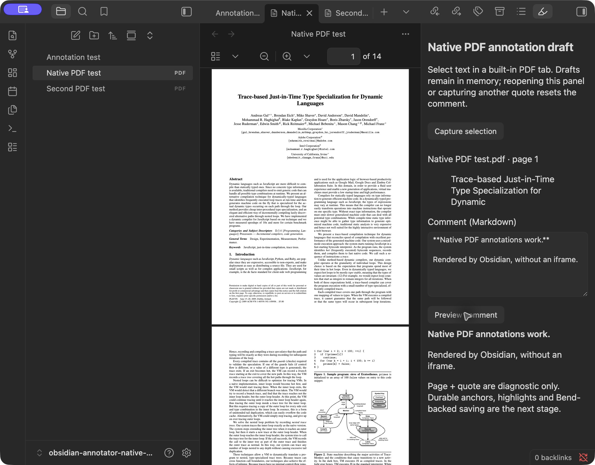

# Native PDF live test results

Historical results for the in-memory **0.0.1** spike. Persistent highlights and
Markdown saving were added afterward; see [HIGHLIGHT_TEST_RESULTS.md](HIGHLIGHT_TEST_RESULTS.md)
for the current implementation and evidence.

Tested 2026-10-30 on macOS 26.6.2, installed Obsidian **1.13.7**, using the
prototype built from commit `dcbaf7d` (Obsidian declaration package 1.11.4).
No implementation changes were needed during this test.

The prototype ran in a separate vault:
`~/Documents/obsidian-annotator-native-test`.
The existing personal vault was not used for the experiment. The test vault
has only our prototype installed, a test annotation note, and two copies of the
public PDF.js example already bundled in this repository. The second copy has
a distinct filename; this tests file association, not two different PDF contents.

## Observed results

| Check | Observed result | Screenshot |
| --- | --- | --- |
| Enable prototype | Plugin commands appeared in the live command palette | Confirmed during setup |
| Open local annotation-target | Command opened the built-in PDF tab and native sidebar, with the host toolbar and page count | [01](evidence/01-native-viewer-open.png) |
| Capture native text selection | Selecting the first title line populated the exact quote and `Native PDF test.pdf · page 1` | [02](evidence/02-native-selection-captured.png) |
| Comment editor and Markdown preview | Bold, list and inline-code markup rendered through Obsidian's MarkdownRenderer | [03](evidence/03-markdown-preview.png) |
| Native zoom | Host zoom-in button enlarged the PDF while the draft and rendered comment remained intact | [04](evidence/04-native-zoom-and-preview.png) |
| Second PDF | Selecting Abstract in the other tab changed the capture to `Second PDF test.pdf · page 1` | [05](evidence/05-second-pdf-selection.png) |
| Page navigation | Entering page 2 in the native toolbar and selecting its first line produced `Second PDF test.pdf · page 2` | [06](evidence/06-page-two-selection.png) |
| Non-PDF selection | Selected text in the Markdown note, invoked capture command: visible refusal, prior PDF draft remained unchanged | [07](evidence/07-non-pdf-selection-refused.png) |
| Reload lifecycle | Reload app without saving cleared the in-memory capture; restored sidebar showed No selection captured yet | [08](evidence/08-reloaded-draft-cleared.png) |
| Live DOM | Read-only developer-console query returned zero iframe elements, four native text layers, one draft panel | [09](evidence/09-runtime-dom-check.png) |
| Capture after reload | Returning to page 1, selecting its title and previewing a fresh comment worked again | [10](evidence/10-capture-after-reload.png) |

The exact read-only console query in screenshot 09 was:

```js
JSON.stringify({
  iframeCount: document.querySelectorAll("iframe").length,
  nativeTextLayers: document.querySelectorAll(".textLayer").length,
  draftPanels: document.querySelectorAll(".annotator-native-spike").length
})
// {"iframeCount":0,"nativeTextLayers":4,"draftPanels":1}
```

Screenshots are original, unedited app-window captures, not generated mockups.
[evidence/sha256.json](evidence/sha256.json) records their hashes. The initial
setup showed an ambiguous unchecked value through accessibility for the plugin
toggle; the live command palette and running sidebar confirmed successful
activation. The screenshots show actual successful operation after setup.

After the test, both PDF copies were compared byte-for-byte with the repository
fixture, and the annotation note was compared with its original content. All
were unchanged. The installed plugin's three files also matched the built
artifacts. Obsidian did write its normal settings/workspace state in the isolated
vault. The test vault remains available with the prototype enabled and a native
PDF/draft demonstration open. No change was pushed remotely.

## Limits of this evidence

This establishes that the first native-viewer/UI integration works on this
machine and app version. It does not establish a complete annotation system:
there is still no durable selector generation, existing-annotation resolution,
highlight painting or Bend-backed save path in this prototype. Comments are
intentionally volatile. No content was saved into annotation blocks.

The test exercised ordinary PDF tabs with two file paths, page navigation,
zoom, selection, preview, refusal and a full vault reload. Separate plugin
disable/enable, same-file split panes, pop-out windows, page-boundary/keyboard
selection, mobile, rotation, large PDFs, external edits and future Obsidian DOM
changes remain untested. File-selection event behavior and native DOM APIs
remain host-specific boundaries, independent of the Bend storage proofs.

## Representative screenshot


